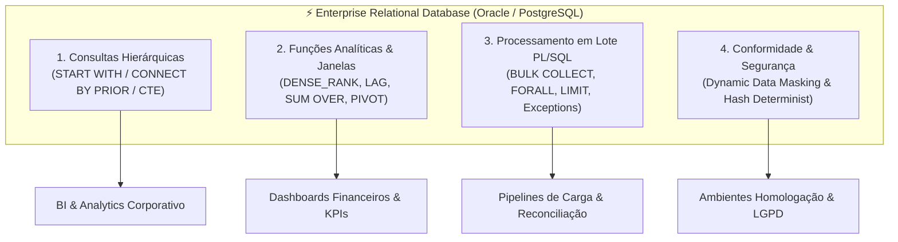

# Enterprise SQL & PL/SQL Architecture Patterns (Oracle & PostgreSQL)

[](https://opensource.org/licenses/MIT)
[](https://www.oracle.com/database/)
[](https://www.postgresql.org/)
[](#)
[](#)

Repositório técnico corporativo contendo padrões arquiteturais avançados de modelagem, otimização e processamento analítico em **Oracle SQL**, **PL/SQL** e **PostgreSQL**.

---

## 🎯 Padrões Técnicos Demonstrados



---

## 📁 Estrutura do Laboratório

```plaintext
advanced-sql-oracle-lab/
├── schema/
│   └── 01_ddl_enterprise_schema.sql         # Modelagem DDL de tabelas e índices relacionais
├── hierarchical_queries/
│   └── hierarchical_tree_traversal.sql       # Árvores de subordinação (CONNECT BY vs Recursive CTE)
├── window_functions/
│   └── analytics_window_and_pivot.sql        # Rankings, percentis, janelas móveis e PIVOT
├── plsql_patterns/
│   └── batch_processing_bulk_collect.sql     # Packages de alto rendimento com PGA otimizada
├── data_masking_etl/
│   └── dynamic_data_masking.sql              # Técnicas de anonimização e mascaramento em view
├── LICENSE                                   # Licença MIT
└── README.md                                 # Guia técnico e documentação de arquitetura
```

---

## 💡 Destaques de Performance e Engenharia de Dados

1. **Minimização de Context Switch:** Demonstração prática do uso de `BULK COLLECT INTO ... LIMIT` e `FORALL ... SAVE EXCEPTIONS` para evitar alternância contínua entre o compilador SQL e o motor PL/SQL.
2. **Resolução de Estruturas em Árvore:** Uso de `SYS_CONNECT_BY_PATH` e `CONNECT_BY_ISLEAF` no Oracle para processamento de estruturas departamentais profundas com tempo de resposta em sub-segundos.
3. **Segurança por Design (LGPD/GDPR):** Mecanismos de anonimização determinística via `STANDARD_HASH(..., 'SHA256')` permitindo que dados sigilosos sejam mascarados para relatórios analíticos sem quebrar a consistência relacional.

---

## 👤 Autor

**Marcos Vasconcellos de Andrade**  
*Consultor de TI & Especialista em Infraestrutura Linux, Engenharia de Dados & IA Privada*  
- **GitHub:** [@marcos-data-engineer](https://github.com/marcos-data-engineer)  
- **LinkedIn:** [Marcos Vasconcellos de Andrade](https://www.linkedin.com/in/marcos-data-engineer)  
- **Blog:** [Arquitetura de Dados & IA](https://marcos-data-engineer.github.io/blog/)  
